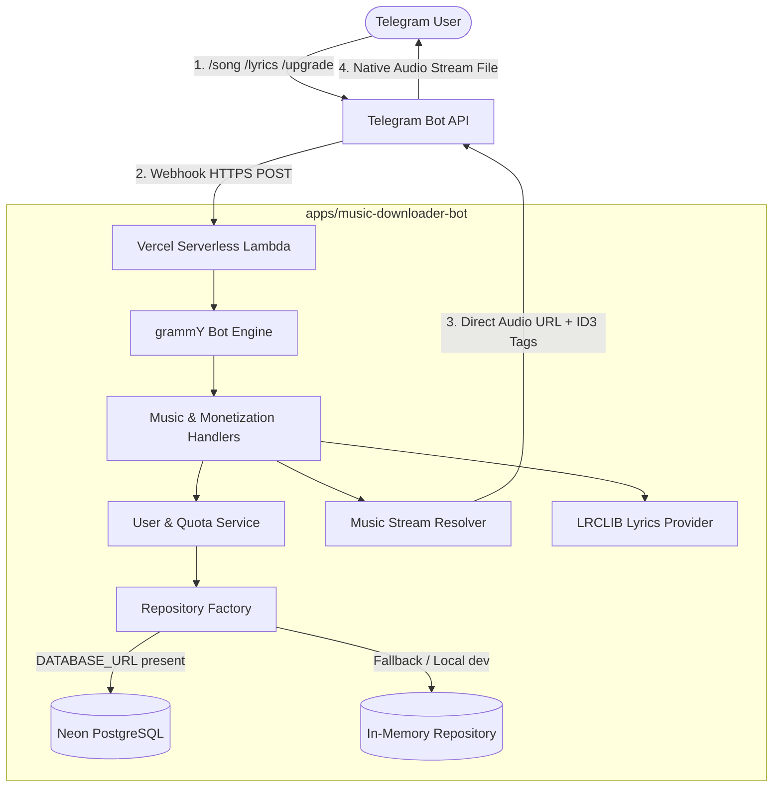

# 🎵 Product Roadmap & Engineering Master Plan: Music Discovery & Downloader Bot

**Project:** `apps/music-downloader-bot`  
**Current Status:** Production-Ready & Tested (Phases 1–10 Complete)  
**Architecture:** Clean / Layered Architecture (TypeScript, grammY, Vercel Serverless, Neon PostgreSQL)  
**Contact:** `tinonurcahya.ti@gmail.com`  

---

## 📌 1. Executive Summary

The **Music Discovery & Audio Downloader Bot** is an enterprise-grade Telegram bot engineered to deliver seamless music discovery, real-time audio playback, high-definition album art, synchronized karaoke lyrics, and freemium quota monetization via **Telegram Stars (`XTR`)**.

By offloading audio transcoding to global music CDNs (Deezer, Apple iTunes, JioSaavn) and lyrics delivery to LRCLIB, the bot completely bypasses the traditional 4.5MB payload bottleneck and 10-second timeout limits of serverless architectures (Vercel Lambda).

---

## 🏛️ 2. Architectural Blueprint



---

## 💎 3. Monetization & Freemium Quota Strategy

### 3.1 Freemium Daily Quota
- **Free Learners**: **5 full song downloads per day**.
- **Always Free**: 30s Audio Previews, Track Search, and Full Lyrics remain 100% free and unlimited.
- **Quota Reset**: Automatically resets at 00:00 UTC (07:00 WIB).

### 3.2 Telegram Stars (`XTR`) Subscription Tiers & 12-Hour Faster Reset
- **Fair Usage Policy (FUP)**: **50 unduhan per siklus 12 jam** (reset otomatis 2x sehari pada pukul 07:00 WIB dan 19:00 WIB).

| Plan Identifier | Duration | Telegram Stars (`XTR`) | Discount / Value |
| :--- | :--- | :--- | :--- |
| `plan_1m` | 30 Days (1 Bulan) | `25 Stars` | 50 unduhan/12 jam & HD 320kbps |
| `plan_3m` | 90 Days (3 Bulan) | `60 Stars` | Hemat 20% dibanding bulanan |
| `plan_lifetime` | Lifetime (Seumur Hidup) | `99 Stars` | Sekali bayar akses selamanya |

### 3.3 Free Trial 7 Hari (`/trial`)
- Every new user can activate a **1-time 7-Day Free Trial** (`trial_7d`) with zero upfront payment, unlocking 50 downloads per 12-hour cycle & HD 320kbps.

### 3.4 Viral Referral Loop (`/invite`)
- Shareable Telegram link: `https://t.me/<bot_username>?start=ref_<telegram_id>`.
- Rewards:
  - Invitee gets: **+3 Extra Download Quota**.
  - Inviter gets: **+3 Extra Download Quota**.
- Anti-Tamper & Sybil Defense: Mencegah self-referral (`inviter === invitee`) dan hanya berlaku untuk pendaftar baru.

### 3.5 Audio Bitrate & Quality Differentiation
- **Free Tier (160kbps Standard)**: Unduh audio kualitas standar 160kbps dengan kuota 5 lagu per 24 jam.
- **Premium VIP & Free Trial (320kbps Studio HD)**: Unduh audio kualitas rekaman studio 320kbps dengan kuota 50 lagu per siklus 12 jam.
- **Interactive HD Upsell Modal**: Saat pengguna Free menekan tombol `[ 💎 Unduh HD (320kbps) ]`, bot tidak memotong kuota harian, melainkan menampilkan kartu edukasi audio studio dengan tombol aktivasi Free Trial 7 Hari, menu Stars, dan opsi `[ 📥 Tetap Unduh Versi 160kbps ]`.

### 3.6 Extra Quota Boost (Instant Top-Up)
Saat kuota 50 lagu per 12 jam habis, pengguna VIP dapat membeli kuota instan tanpa menunggu siklus reset:
- `boost_25`: **+25 Lagu Instan (10 Stars)**
- `boost_50`: **+50 Lagu Instan (18 Stars)**

---

## 💾 4. Database Schema Specification (Neon PostgreSQL)

### Table 1: `music_users`
```sql
CREATE TABLE IF NOT EXISTS music_users (
    telegram_id BIGINT PRIMARY KEY,
    username TEXT,
    first_name TEXT,
    total_downloads INTEGER DEFAULT 0,
    daily_download_count INTEGER DEFAULT 0,
    daily_download_date TEXT DEFAULT '',
    bonus_quota INTEGER DEFAULT 0,
    is_premium BOOLEAN DEFAULT FALSE,
    premium_tier TEXT DEFAULT '',
    premium_until TEXT DEFAULT '',
    has_used_trial BOOLEAN DEFAULT FALSE,
    invited_by BIGINT DEFAULT 0,
    created_at TEXT DEFAULT '',
    last_active TEXT DEFAULT ''
);
```

### Table 2: `music_referrals`
```sql
CREATE TABLE IF NOT EXISTS music_referrals (
    id SERIAL PRIMARY KEY,
    inviter_id BIGINT NOT NULL,
    invitee_id BIGINT NOT NULL UNIQUE,
    created_at TEXT DEFAULT ''
);
```

### Table 3: `music_audio_cache` (Instant Delivery CDN Bypass)
```sql
CREATE TABLE IF NOT EXISTS music_audio_cache (
    id TEXT PRIMARY KEY, -- format: <track_id>:<quality>
    file_id TEXT NOT NULL,
    created_at TEXT DEFAULT ''
);
```

---

## ⚡ 5. Command Reference

| Command | Action | Quota Impact |
| :--- | :--- | :--- |
| `/start` | Sambutan interaktif, aktivasi bonus referral jika via link `ref_<id>` | Free |
| `/song <judul>` | Cari lagu dan tampilkan kartu lagu teratas + cover HD + tombol player | Free |
| `/charts` atau `/trending` | Buka menu Top 10 Hits Global & Indonesia dengan tombol nomor lagu instan | Free |
| `/lyrics <judul>` | Cari dan tampilkan lirik lengkap (plain & karaoke synced) | Free |
| `/profile` | Tampilkan status kuota siklus ini, sisa hari aktif, & jumlah download | Free |
| `/upgrade` | Tampilkan menu durasi paket langganan Telegram Stars (`XTR`) | Free |
| `/trial` | Klaim langsung Free Trial 7 Hari (1x per akun) | Free |
| `/invite` | Dapatkan link referral personal untuk mengumpulkan bonus kuota (+3) | Free |
| `/stats` atau `/admin` | Dashboard analitik: total user, download, donatur VIP, & server health | Admin Only |
| `/help` | Panduan lengkap cara mencari lagu, download, dan inline query | Free |

---

## 🛡️ 6. Security & Anti-Tampering Matrix

1. **Pre-Checkout Anti-Tampering**:
   - Currency Guard: Menolak keras transaksi jika mata uang bukan `XTR`.
   - Price Guard: Menolak pre-checkout jika jumlah Stars diubah (misal mencoba bayar 1 Stars untuk paket Lifetime 99 Stars).
   - Payload Guard: Menolak faktur dengan payload di luar katalog resmi.
2. **Webhook Security**:
   - Validasi header `X-Telegram-Bot-Api-Secret-Token` saat request tiba dari Telegram.
3. **Double-Click & Concurrency Defense**:
   - Flag `has_used_trial` mencegah pengguna mengklaim trial berulang kali.
